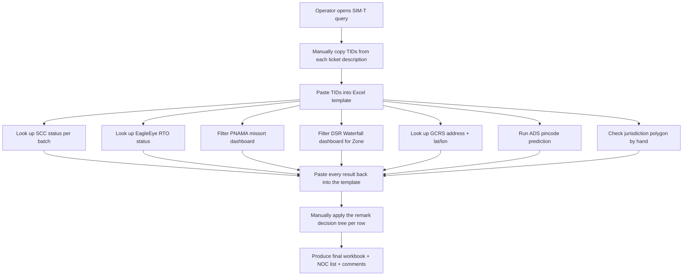
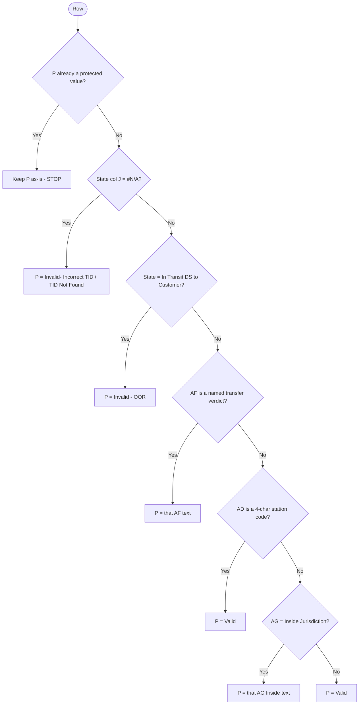
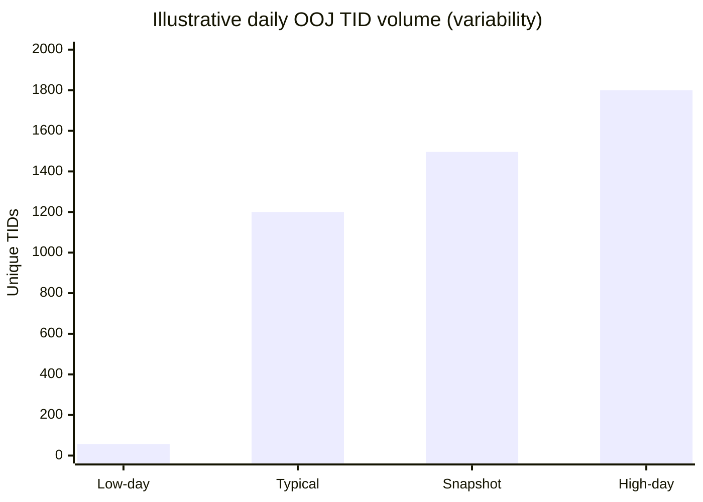
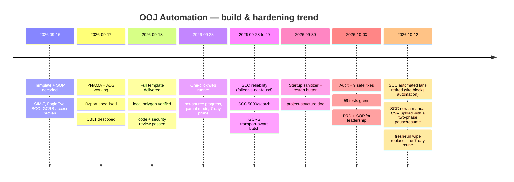

# Product Requirements Document (PRD)
## SWA India — Out-of-Jurisdiction (OOJ) Process Automation

| | |
|---|---|
| **Document type** | Product Requirements Document (PRD) |
| **Product / project** | OOJ Process Automation |
| **Org / team** | SWA India — Out-of-Jurisdiction resolver group |
| **Author & builder (Individual Contributor)** | **KABIDEBA** |
| **Status** | Live / In production use (local, operator-run) |
| **Document version** | 1.0 |
| **Last updated** | 2026-10-03 |

> **Credit:** This automation was designed, built, tested, and documented end to end by
> **KABIDEBA** as an individual contributor — from reverse-engineering the manual Excel
> template and SOP, through building every source-integration lane, the orchestrator, the
> remark decision engine, and the one-click local web runner, to the verification and
> safety layers that gate every output.

---

## 1. Executive summary

Every day, the SWA India team must identify and action **Out-of-Jurisdiction (OOJ)**
shipment tickets: packages whose delivery address may fall outside the station's assigned
jurisdiction. The legacy process was **fully manual** — an operator pulled tickets, copied
tracking IDs (TIDs) by hand into a large Excel template, then visited **eight separate
Amazon internal tools** per batch to look up each TID's status, address, zone, pincode
prediction, missort history, and jurisdiction, before manually applying a multi-step
decision tree to mark each ticket Valid or Invalid.

For a typical day of **1,400–1,500 TIDs**, this consumed hours of repetitive, error-prone
copy-paste work, and the output quality depended on operator fatigue and consistency.

The **OOJ Process Automation** replaces that manual workflow with a **one-click local web
application**. The operator starts a run, and the system pulls the tickets, enriches every
TID across all source tools, applies the exact remark rules, fills the Excel template,
recalculates it, **verifies the result**, and produces a ready-to-use workbook — in roughly
**15–25 minutes**, with **zero manual lookups**.

It is **free** (Python standard library plus a few well-known open-source packages),
**runs entirely on the operator's laptop**, uses **no AI/LLM in the run path**, and is
**strictly read-only** against all Amazon systems (it never posts to, resolves, or modifies
any ticket or source).

---

## 2. Problem statement

### 2.1 The manual process (before)

### 2.2 Pain points

| # | Pain point | Impact |
|---|---|---|
| P1 | **8 tools, manual lookups** per TID batch | Hours of repetitive work daily |
| P2 | **Copy-paste between tools and Excel** | High risk of transcription errors |
| P3 | **Manual decision tree** across columns AF/AD/AG + State | Inconsistent remarks under fatigue |
| P4 | **No verification** of the final file | Silent errors reach the output |
| P5 | **Volume volatility** (56 → ~1,800 TIDs/day) | Heavy days overwhelm the operator |
| P6 | **Knowledge concentrated in one person** | No repeatable, documented procedure |

### 2.3 Why now

The volume is both high and highly variable, the decision logic is well-defined (and thus
automatable), and all source tools are reachable from the operator's authenticated
sessions. The process is a textbook candidate for deterministic, rule-based automation —
no judgment call that a documented rule cannot encode.

---

## 3. Goals and non-goals

### 3.1 Goals

| # | Goal | How it is measured |
|---|---|---|
| G1 | Eliminate manual per-TID lookups across all 8 sources | 0 manual lookups in a normal run |
| G2 | Produce a correct, verified filled workbook | Read-back + polygon verification pass before download unlocks |
| G3 | Reduce end-to-end time | ~15–25 min for ~1,500 TIDs vs. hours manually |
| G4 | Make the process repeatable and documented | One-click web app + full doc set + SOP |
| G5 | Keep it free, local, and safe | No paid services, runs on the laptop, read-only |
| G6 | Apply the remark rules exactly and consistently | Rules encoded as pure functions + unit tests (59 passing) |

### 3.2 Non-goals (explicitly out of scope)

| # | Non-goal | Rationale |
|---|---|---|
| N1 | **Writing to Amazon systems** (posting comments, resolving tickets) | Read-only by design; write actions stay behind a future explicit, gated approval |
| N2 | **Any AI/LLM in the run path** | Deterministic rules only; reproducible and auditable |
| N3 | **OBLT (EVENT_414) lookups** | Removed from scope by the operator (2026-09-17) |
| N4 | **A hosted/multi-user service** | Local-per-operator using each operator's own Midway/SSO sessions |
| N5 | **Re-enabling Working Sheet column removal** | Deleting columns shifts the grid and breaks formulas; intentionally disabled |

---

## 4. Users and personas

| Persona | Who | Needs |
|---|---|---|
| **Operator** | SWA India OOJ resolver (today: KABIDEBA) | Run the daily process quickly and get a correct workbook with minimal clicks |
| **Team lead / manager** | Reviews output and productivity | Confidence the output is correct, verifiable, and consistent day to day |
| **Maintainer** | Whoever extends the tool (today: KABIDEBA) | Clear code layout, tests, and docs to change a source or rule safely |

---

## 5. Scope and the solution

### 5.1 What the operator sees

A **single local web page** (`http://127.0.0.1:8000/`) with four steps: grant Midway
access, approve the ADS upload, start the run, and download the verified workbook. Live
per-source progress cards (with % bars and counts), a live log with a **Copy log** button,
per-source CSV downloads, a **Stop run** control, and a **Download** button that only
unlocks when the output passes verification.

### 5.2 The pipeline (end to end)

```mermaid
flowchart LR
    subgraph Input
      T["SIM-T Tickets"]
    end
    subgraph Enrichment
      SCC["SCC - status/station"]
      EE["EagleEye - RTO"]
      PN["PNAMA - missort"]
      DSR["DSR - Zone"]
      GC["GCRS/SIW - address + geo"]
      PG["Polygon - jurisdiction"]
      ADS["ADS - pincode predict"]
    end
    subgraph Output
      FL["Fill template"]
      RC["Excel recalc"]
      RB["Read-back verify"]
      RM["Apply remark rules"]
      DL["Download workbook"]
    end
    T --> SCC --> EE --> PN --> DSR --> GC --> PG --> ADS --> FL --> RC --> RB --> RM --> DL
```

**Execution model:** the run is split into **two phases with a manual pause**. Phase A
pulls the SIM-T tickets, then stops. **SCC is now a manual CSV upload** (SCC's site
blocks automated browsing, so the automated lane was retired): the operator searches
the TIDs in SCC themselves, exports the CSV, and uploads it via the web page, which
auto-resumes the run as Phase B. SCC's rows still feed GCRS/Polygon/ADS. In Phase B,
EagleEye is a pure API that runs on a **background thread overlapping** the serial
browser lanes (PNAMA/DSR), which share one Edge profile and stay serial by design.

### 5.3 Data sources

| # | Source | Provides | Access lane | Browser? |
|---|---|---|---|---|
| 1 | **SIM-T** | Tickets → TIDs (Tech_Data, row order) | builder-mcp | No |
| 2 | **EagleEye** | RTO status (`REVERSE`) | MCP API over Midway cookie | No |
| 3 | **SCC** | State, Destination, Source station, Ship option | Manual CSV upload (automated browser lane retired — site blocks automation) | No (operator exports in their own browser) |
| 4 | **PNAMA** | Missort / earlier-delivered match | QuickSight UI export | Yes |
| 5 | **DSR** | Zone per TID | QuickSight UI export | Yes |
| 6 | **GCRS / SIW** | Geocoded address, lat/lon, pincode | mcscli → Edge fallback | Fallback only |
| 7 | **Polygon** | Inside/Outside jurisdiction | SIW `gs`+`gr` (realtime) | No |
| 8 | **ADS** | Predicted pincode + probability | Streamlit UI | Yes |

### 5.4 The remark decision engine

The heart of the accuracy guarantee. Column **P ("Remark")** is rewritten from its template
formula to a final literal value using a strict, ordered decision tree:

There are **six protected remark values** that, once present, are never overwritten.
Full detail: `Docs/remark-rules.md`.

---

## 6. Requirements

### 6.1 Functional requirements

| ID | Requirement | Priority |
|---|---|---|
| FR1 | Pull the day's OOJ tickets from SIM-T and explode to one TID per row, preserving order and duplicates | Must |
| FR2 | Enrich every TID across SCC, EagleEye, PNAMA, DSR, GCRS, Polygon, ADS | Must |
| FR3 | Fill the Excel template and recalculate all formula columns | Must |
| FR4 | Apply the six-protected-value remark decision tree to column P | Must |
| FR5 | Verify the output (row/TID alignment, 25-column contract, no unexpected Excel errors, polygon re-check) before unlocking download | Must |
| FR6 | One-click local web UI with live per-source progress, log, and gated download | Must |
| FR7 | Per-source CSV download links | Should |
| FR8 | **Partial mode** — produce the workbook with a failed source left blank (labelled PARTIAL) | Should |
| FR9 | **Stop run** control and a **Restart server** button | Should |
| FR10 | Copy the verified workbook to the Desktop automatically | Should |

### 6.2 Non-functional requirements

| ID | Requirement | Target / rule |
|---|---|---|
| NFR1 | **Read-only** against all Amazon systems | No writes, ever, without explicit future gating |
| NFR2 | **No AI/LLM** in the run path | Deterministic rules only |
| NFR3 | **Local & free** | Runs on the laptop; Python stdlib + common OSS packages |
| NFR4 | **Live data only** | Startup sanitizer clears stale/partial scratch so a run can't reuse yesterday's file |
| NFR5 | **Count-verified output** | Every lane cross-checks identity/extra/duplicate counts |
| NFR6 | **Performance** | ~15–25 min for ~1,500 TIDs |
| NFR7 | **Safe parallelism only** | Shared-Edge lanes stay serial; `/grbi` sequential; EagleEye + polygon fan-out are the only proven-safe concurrency |
| NFR8 | **Auditability** | Every run logs to a file; a fresh-run wipe clears all prior run data at each Start (keeping this run's data, the SCC enum overlay, and today's exports) |
| NFR9 | **Testability** | Core logic unit-tested offline (59 tests passing) |

### 6.3 Safety and compliance requirements

- Never posts to, resolves, or modifies any ticket or source system.
- Runs as the operator, using the operator's own Midway/SSO sessions.
- ADS upload (which sends addresses to a plaintext endpoint) requires an explicit per-run
  approval checkbox.
- Untrusted CSV values are written as Excel **literals**, never as formulas.

---

## 7. Success metrics and KPIs

| KPI | Baseline (manual) | With automation | Status |
|---|---|---|---|
| Manual per-TID lookups | 8 tools × ~1,500 TIDs | **0** | ✅ Met |
| End-to-end run time (~1,500 TIDs) | Several hours | **~15–25 min** | ✅ Met |
| Output verification | None (manual eyeball) | **Automated gate** (read-back + polygon) before download | ✅ Met |
| Remark consistency | Operator-dependent | **Rule-encoded + 59 unit tests** | ✅ Met |
| Clicks to produce the file | Many | **~4** (grant → approve → start → download) | ✅ Met |
| Cost | Operator time | **$0 software** (local, OSS) | ✅ Met |

---

## 8. Trends and operating history

### 8.1 Daily TID volume (observed)

Daily OOJ volume is **high and highly variable** — the backlog swings roughly **56 → ~1,800
TIDs** day to day; a large change is expected, not a defect. A representative verified live
snapshot processed **788 tickets → ~1,560 Working Sheet rows / ~1,496 unique TIDs**.

> *The bars illustrate the observed range (low ≈ 56, high ≈ 1,800) with the verified live
> snapshot ≈ 1,496. Exact daily figures come from each run's `summary.json`.*

### 8.2 Capability maturity trend

### 8.3 Quality trend

- Test suite grew to **59 passing** offline unit tests covering the polygon workflow, the
  web-controller download gates, the remark rules (every branch), and the capture sanitizer.
- A read-only audit (2026-10-03) found **no data-corrupting defect**; the follow-up applied
  **9 behavior-preserving fixes** (doc accuracy, dead-code removal, path centralization,
  retention protection, redundant-read removal) with tests kept green.

---

## 9. Risks and mitigations

| Risk | Likelihood | Impact | Mitigation |
|---|---|---|---|
| A source UI changes (SCC/PNAMA/DSR/ADS) | Medium | Lane fails | Each lane fails loudly with screenshots; partial mode keeps the run usable; troubleshooting doc |
| Source tool outage (e.g. SCC bulk search down) | Medium | Lane blank | Partial mode; re-run when restored |
| Auth/session expiry (Midway, Edge profile) | Medium | Lane fails | Clear login messages; `mwinit -o` + profile sign-in; mcscli → Edge fallback for GCRS |
| Operator-specific hard-coded paths (Edge profile) | Low | Breaks on a new machine | Centralized to one constant with `OOJ_EDGE_PROFILE` env override |
| Stale data reused | Low | Wrong output | Startup sanitizer clears partial/stale scratch; live-data-only rule |
| Single-maintainer knowledge | Medium | Bus factor | Full doc set + this PRD + the SOP |
| ADS plaintext endpoint | Known | Address data over HTTP | Explicit per-run approval checkbox; documented |

---

## 10. Rollout and operations

- **Deployment model:** local-per-operator. Each operator runs their own copy using their
  own Midway/SSO sessions. No hosted service.
- **Launch:** double-click `Start OOJ Web.bat`.
- **Cadence:** aligns to the SOP's two daily query runs (10:30 and 17:30 IST).
- **Support:** `Docs/troubleshooting.md` lists every known failure and its fix; failing
  browser steps save screenshots under `tools/captures/`.
- **Retention:** every fresh Start wipes all prior run folders and per-source capture
  artifacts (not a time-based prune), and prunes old published Desktop exports from a
  previous day; this run's own data, the SCC enum ground-truth file, and today's exports
  are preserved.

---

## 11. Future work (roadmap)

| Item | Description | Status |
|---|---|---|
| Gated write-back | Optional, explicitly-approved posting of per-ticket comments / NOC raise with a dry-run diff first | Deferred (read-only today) |
| Config-driven endpoints/paths | Move remaining hard-coded endpoints into one settings module/env | Partially done (Edge profile centralized) |
| Portability | Make all machine-specific paths configurable for a second operator | Candidate |
| Shared normalizer | One `normalize_tid` across all modules (removes a rare DOC-case edge) | Proposed |
| Headless ADS | Replace the Streamlit UI driver with a batch endpoint if the model team exposes one | Dependent on model team |

---

## 12. Appendix

- **Documentation map:** `README.md`
- **Pipeline detail:** `Docs/pipeline-reference.md`
- **Remark rules:** `Docs/remark-rules.md`
- **Report columns:** `Docs/report-spec.md`
- **Operator SOP:** `Docs/SOP-OOJ-Automation.md`
- **Troubleshooting:** `Docs/troubleshooting.md`
- **Edge cases (live):** `Docs/edge-cases.md`
- **Changelog (live):** `Docs/changes.md`

---

*Authored and built by **KABIDEBA**, SWA India — Out-of-Jurisdiction resolver group.*
*This document is intended for leadership review and team enablement.*
