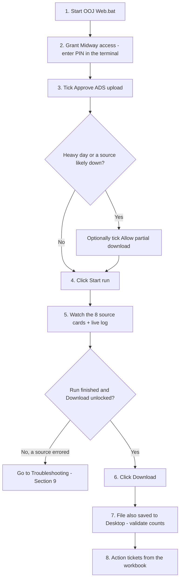
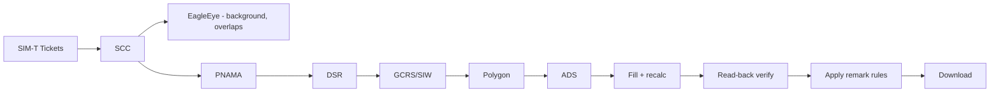
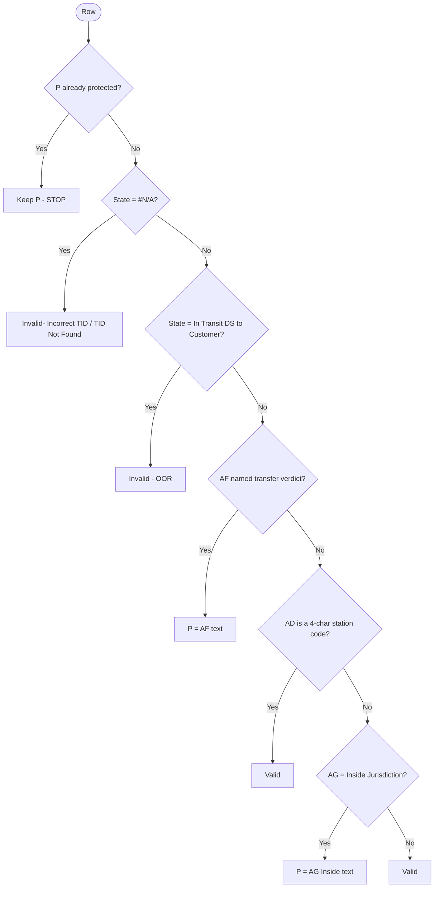
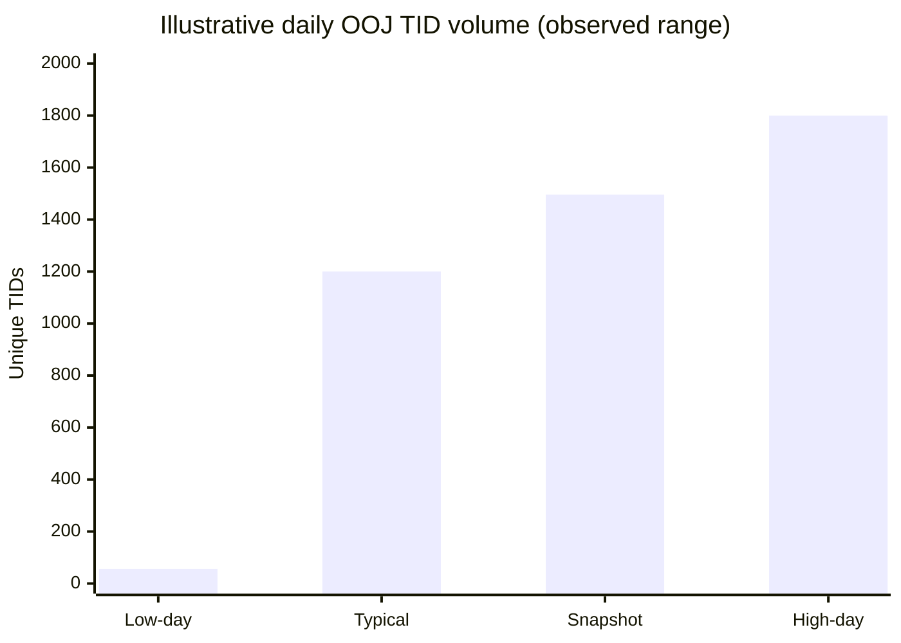
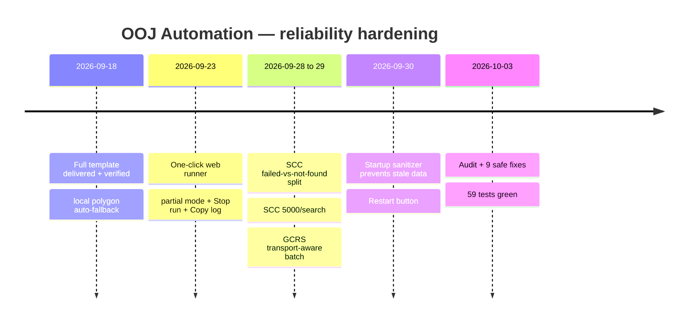

# Standard Operating Procedure (SOP)
## SWA India — Out-of-Jurisdiction (OOJ) Process Automation

| | |
|---|---|
| **Document type** | Standard Operating Procedure (SOP) |
| **Process** | Daily OOJ ticket enrichment & remark workbook |
| **Org / team** | SWA India — Out-of-Jurisdiction resolver group |
| **Author & builder (Individual Contributor)** | **KABIDEBA** |
| **Applies to** | OOJ operators running the automation locally |
| **Status** | Active |
| **Version** | 1.0 |
| **Last updated** | 2026-10-03 |

> **Credit:** This procedure and the automation it describes were created end to end by
> **KABIDEBA** (SWA India OOJ resolver group).

---

## 1. Purpose

This SOP describes how to run the **OOJ Process Automation** to produce the daily, verified
OOJ workbook — replacing the manual, eight-tool, copy-paste process. It covers one-time
setup, the daily run procedure, how the system makes its decisions, what to check, and how
to handle failures.

## 2. Scope

- **In scope:** running the local automation, interpreting progress, retrieving and
  validating the output, and recovering from common failures.
- **Out of scope:** posting comments or resolving tickets (the tool is **read-only**);
  OBLT lookups (descoped); any AI/LLM step (none exists).

## 3. Roles and responsibilities

| Role | Responsibility |
|---|---|
| **Operator** | Runs the daily process, confirms the output, actions tickets from the result |
| **Maintainer (KABIDEBA)** | Owns the code, docs, and fixes; extends sources/rules safely |
| **Team lead** | Reviews output quality and cadence adherence |

## 4. Safety and ground rules (read first)

1. **Read-only.** The automation never posts to, resolves, or modifies any Amazon system.
2. **Live data only.** A startup sanitizer clears stale/partial scratch so a run can never
   reuse yesterday's or a half-finished file.
3. **No AI/LLM** in the run path — the logic is deterministic and auditable.
4. **ADS upload** sends addresses to a plaintext endpoint; it requires the explicit
   per-run **Approve ADS upload** checkbox.
5. **Every run is logged** to a file under `tools/captures/`; artifacts auto-prune after
   7 days.

---

## 5. Prerequisites (one-time setup)

These are already configured on the operator's laptop. Verify them if a run fails at
preflight.

| Prerequisite | Detail |
|---|---|
| **Python 3.13** | On PATH as `py -3.13`, with `openpyxl`, `playwright`, `requests` |
| **Playwright + Edge** | Browser lanes drive Microsoft Edge (`channel="msedge"`) |
| **Midway** | `mwinit -o` produces the session cookie the API lanes need (refresh daily) |
| **mcscli** | `C:\Program Files\Common Files\AmazonMidwayClientSuite\bin\mcscli.exe` (SIW/GCRS) |
| **builder-mcp** | `C:\Users\kabideba\AppData\Local\Toolbox\bin\builder-mcp.exe` (SIM-T pull) |
| **Automation Edge profile** | Signed in to **SCC** (`logistics.amazon.in`) and the **PNAMA** + **DSR** QuickSight dashboards |

> **Before a heavy run:** confirm the automation Edge profile is signed in to SCC, PNAMA,
> and DSR. One sign-in usually covers both QuickSight dashboards.

---

## 6. Daily operating procedure

### 6.1 Cadence

Run aligned to the two daily SIM-T query windows: **10:30 and 17:30 IST**. All valid TIDs
from both runs must be actioned before EOD per the OOJ SOP.

### 6.2 The procedure, step by step

**Detailed steps:**

1. **Start the app.** Double-click **`Start OOJ Web.bat`** (or run
   `py -3.13 tools\web\server.py`). It serves **http://127.0.0.1:8000/** and opens the
   browser. If the page doesn't load, check the launcher window for the actual port — it
   falls back through 8000/8080/8090/3000/5000/9000.
2. **Grant Midway access (step 1 on the page).** Click **Grant Midway access**; a terminal
   opens running `mwinit -o` — enter your PIN and approve. Start unlocks once valid. Once
   per session.
3. **Approve ADS upload (step 2).** Tick **Approve ADS upload** (required for a complete
   workbook). Optionally tick **Allow partial download if a source fails** for a resilient
   run on a heavy day; leave it **off** for a strict full run.
4. **Start the run.** Click **Start run**.
5. **Monitor progress (step 3).** Eight source cards (SIM-T, EagleEye, SCC, PNAMA, DSR,
   GCRS, Polygon, ADS) show running/done/error with a **% bar** and counts. Below: the live
   table and the **Live log** with **Copy log**. Each source exposes a **Download CSV** link
   once it has data. **Stop run** aborts if needed.
6. **Retrieve the result (step 4).** When the run finishes, verification runs automatically
   (read-back + polygon). **Download** unlocks only when the workbook is valid. The file is
   also copied to the **Desktop** as `OOJ_Process_Filled_<stamp>.xlsx`
   (or `..._PARTIAL_<stamp>.xlsx`).

### 6.3 Expected timing

A full run of ~1,400–1,500 TIDs takes roughly **15–25 minutes**, dominated by the browser
lanes (SCC/PNAMA/DSR — DSR's dashboard is the slowest to load, up to ~3 minutes) and GCRS.
EagleEye and fill/verify are fast.

---

## 7. How the automation works (reference)

### 7.1 Pipeline order

- **SCC runs first** — its resolved TIDs feed GCRS/Polygon/ADS.
- **EagleEye** is a pure API and runs on a **background thread overlapping** the serial
  browser lanes (PNAMA/DSR).
- Browser lanes (SCC/PNAMA/DSR) share **one** Edge profile, so they run **serially** by
  design. Do not attempt to parallelize them.
- **SCC** pastes up to **5,000 TIDs per search**; ≤1,000 uses the Export-to-CSV button,
  >1,000 triggers SCC's automatic file download.
- **PNAMA/DSR** paste the **entire** TID list into one QuickSight control (no chunking).

### 7.2 The remark decision (column P)

The automation rewrites the Working Sheet **Remark (column P)** to a final value using this
exact, ordered logic. Six values are **protected** — once present they are never changed.

**The six protected values:**
`Invalid - Already RTOed` · `Not Valid - Doesn't belong to SWA` · `Not Valid - Delivered` ·
`Not Valid - In transit DS-DS` · `Invalid- Incorrect TID / TID Not Found` · `Invalid - OOR`.

Full detail: `Docs/remark-rules.md`.

---

## 8. Output validation checklist

Before actioning tickets, confirm:

- [ ] The **Download** button unlocked (verification passed).
- [ ] The run finished **without** a red (error) source card — or, if partial, you knowingly
      ticked **Allow partial download** and the blank source is acceptable.
- [ ] The finish banner lists no unexpected blocked sources.
- [ ] The row count is in the expected range for the day (volume swings 56 → ~1,800 are
      normal, not a defect).
- [ ] The file is present on the **Desktop** with today's stamp.

If any check fails, see Troubleshooting.

---

## 9. Troubleshooting (quick reference)

> First action: on the web page open **Live log** and click **Copy log**. Failing browser
> steps also save screenshots under `tools/captures/<source>/`.

| Symptom | Likely cause | Fix |
|---|---|---|
| "SCC not authenticated" / login page | Edge profile not signed in to `logistics.amazon.in` | Sign in once in that profile, re-run |
| SCC bulk search not returning | Server-side SCC issue | Wait for SCC fix; or re-run with **Allow partial** |
| "Export to CSV never appears" for a chunk | Transient UI/load | Re-run; clicks already scroll-into-view + JS-click fallback |
| "N TID(s) could not be queried after retries" | Chunk failed all retries | TIDs saved to `scc_failed_tids_<stamp>.txt`; re-run |
| PNAMA/DSR "login page — authenticate" | QuickSight not signed in | Sign in to both dashboards once in the profile, re-run |
| DSR looks stuck a few minutes | DSR dashboard is heavy (~3 min load) | Watch the live log; it has a 20-min timeout |
| ADS "host may be down" / no window | ADS Streamlit host intermittently down | Fails fast with a message; re-run when host is back |
| mcscli 302/401 "switching to Edge" | SIW auth mechanism mismatch | **Expected** — auto-fallback to authenticated Edge; not an error |
| Many polygon "retry failed" lines | Transient SIW geometry fetch (realtime, no cache) | Rows get Error status; run still completes |
| "automation Edge profile is open" | An Edge window holds the profile | Close that window, re-run |
| Page won't load / port error | Port blocked by policy | Check launcher window for the actual fallback port |
| Columns/formula errors in the file | (Historical) column removal | Already disabled — all columns kept; produce a fresh run |
| Download stays disabled | Verification/accuracy gate failed | Read the finish banner reason; fix cause or use partial mode |

Full detail: `Docs/troubleshooting.md`. Known gotchas per source: `Docs/edge-cases.md`.

---

## 10. Escalation

| Situation | Action |
|---|---|
| A source tool is down team-wide (e.g. SCC bulk search) | Use **Allow partial**; note it; re-run when the owning team restores service |
| Repeated auth failures after `mwinit -o` + profile sign-in | Capture the log (**Copy log**) and raise to the maintainer (KABIDEBA) |
| Output fails verification repeatedly | Capture the log + the finish-banner reason; raise to the maintainer |
| A rule/scope change from leadership (e.g. HYT2/BOMC special cases) | Route to the maintainer to update the rule config and docs |

---

## 11. Operating trends and context

### 11.1 Volume variability

Daily OOJ TID volume is high and variable — roughly **56 → ~1,800** per day; a verified live
snapshot ran **~1,496 unique TIDs** (788 tickets → ~1,560 rows). Expect day-to-day swings;
they are normal.

### 11.2 Reliability improvements over time

### 11.3 Quality posture

- **59** offline unit tests pass (polygon workflow, web download gates, remark rules,
  sanitizer).
- Every lane **count-verifies** its own output (identity / extra / duplicate checks).
- The download is **gated** behind read-back and polygon verification.

---

## 12. Related documents

| Doc | Purpose |
|---|---|
| `Docs/PRD-OOJ-Automation.md` | Product requirements, metrics, roadmap (leadership) |
| `Docs/user-guide.md` | Operator day-to-day guide |
| `Docs/pipeline-reference.md` | Each stage/source in detail |
| `Docs/remark-rules.md` | Column-P decision logic |
| `Docs/report-spec.md` | Final report columns |
| `Docs/troubleshooting.md` | Known failures and fixes |
| `Docs/edge-cases.md` | Live log of per-source gotchas |
| `Docs/changes.md` | Live changelog |

---

*Authored and built by **KABIDEBA**, SWA India — Out-of-Jurisdiction resolver group.*
*This SOP is intended for operator enablement and leadership review.*
