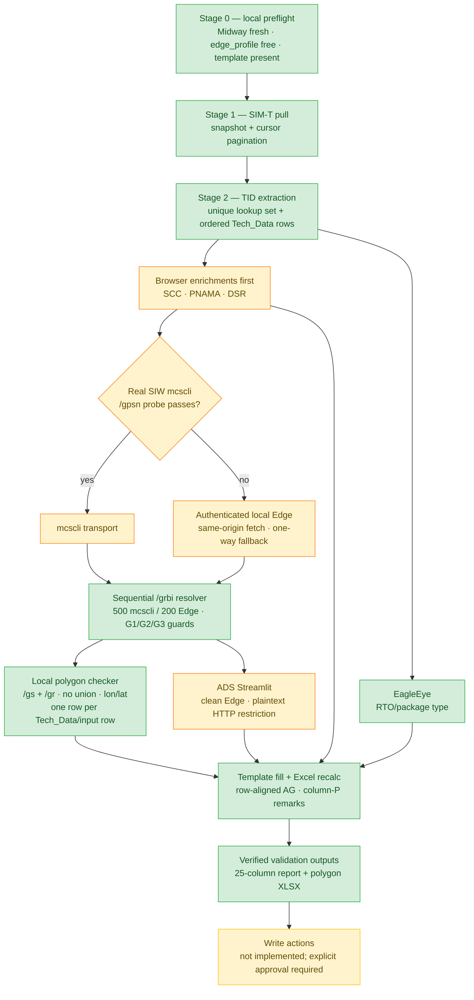
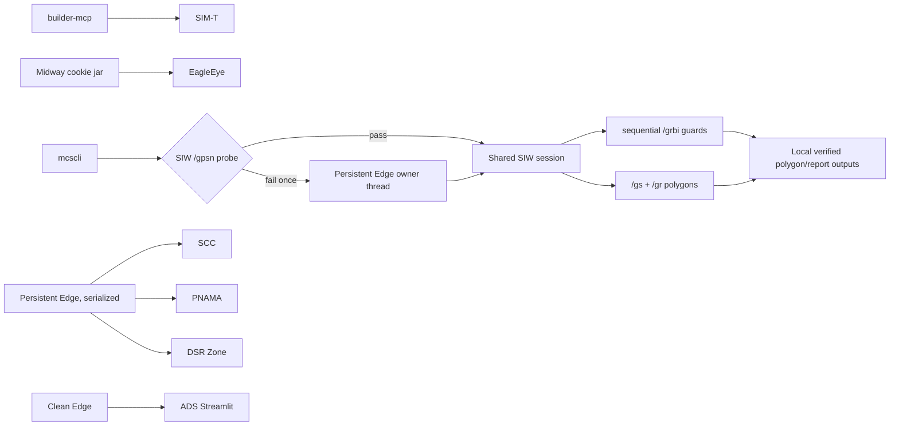
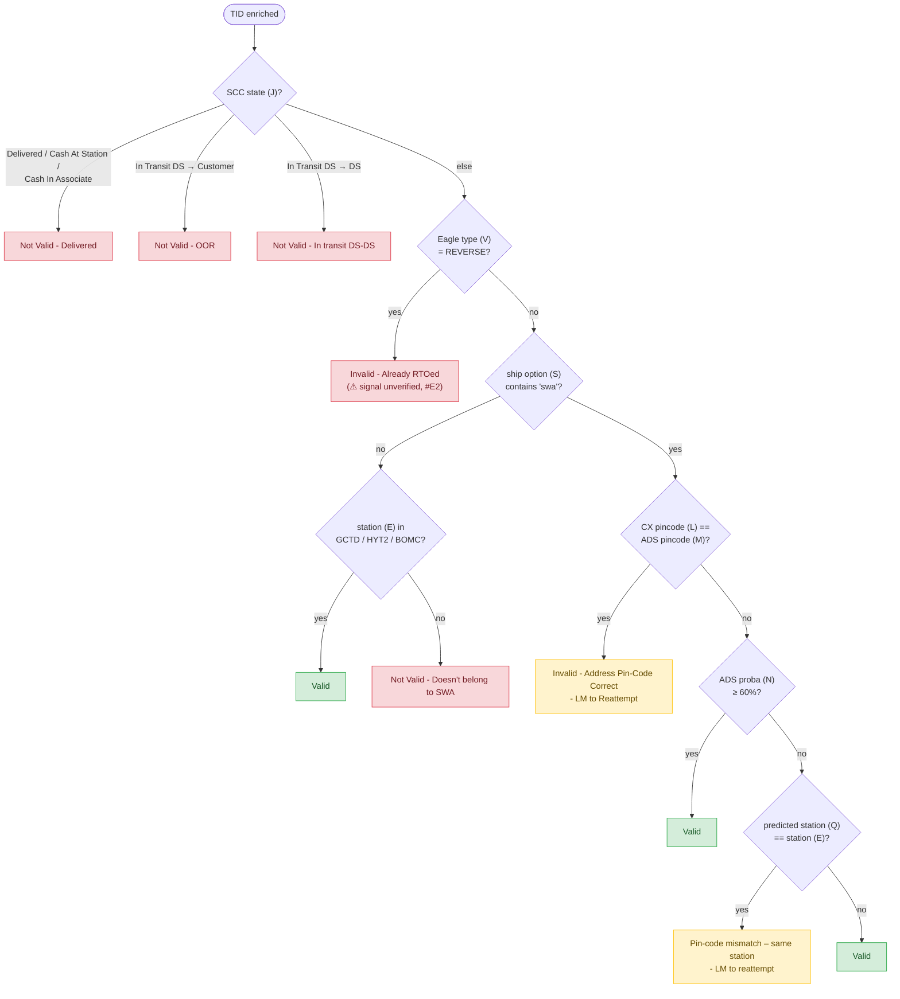
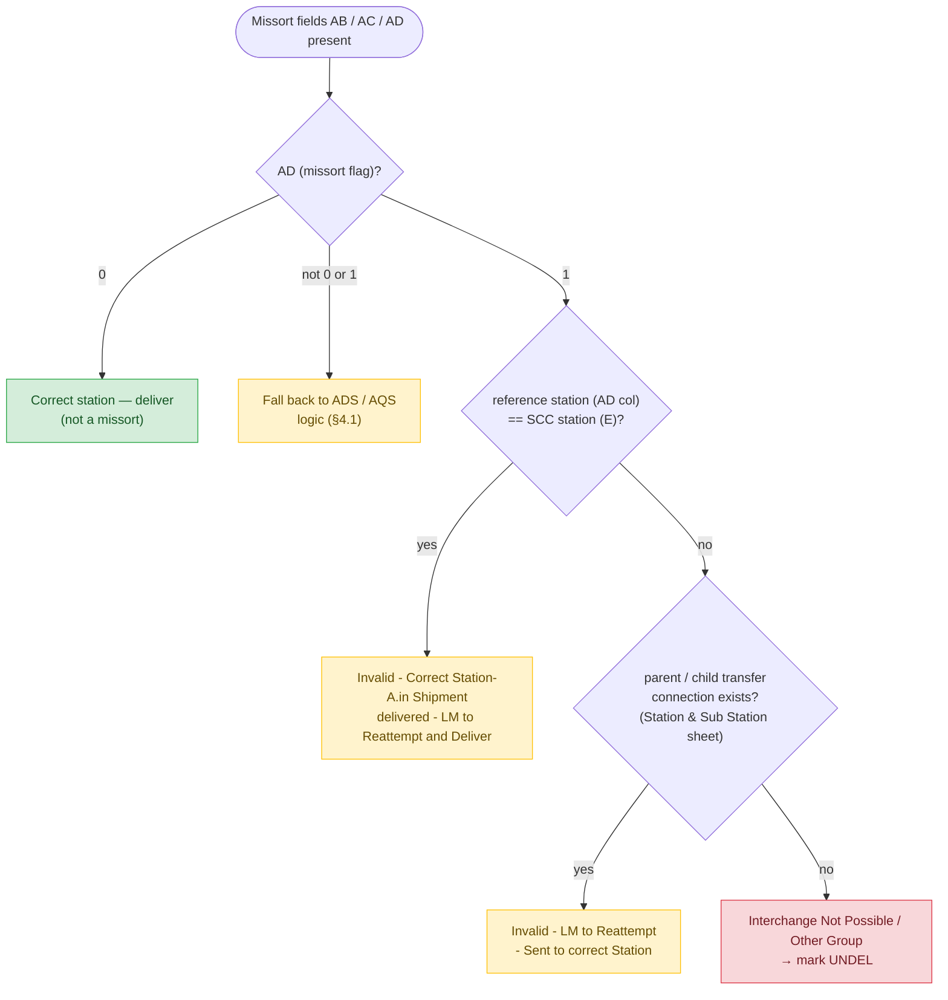

# architecture.md — OOJ Automation Design

Companion to `context.md`. This is the technical design: stages, per-source
integration contracts, auth lanes, and the remark engine.

---

## 1. High-level flow

Green = WORKING today · Orange = confirmed manual path, automation pending · Red = BLOCKED · Yellow = approval-gated (see access-status.md).



## 2. Auth lanes (local Windows)

| Lane | Mechanism | Used for | Notes |
|---|---|---|---|
| builder-mcp | authenticated MCP subprocess | SIM-T | read-only ticket query |
| Midway cookie jar | `~\.midway\cookie` from `mwinit -o` | EagleEye MCP | independent from SIW transport selection |
| mcscli | `mcscli curl` | SIW only after a real `/gpsn` probe | token-valid alone is insufficient; final live probe returned HTTP 302 and correctly selected Edge |
| Playwright + edge_profile | persistent Edge with AEA/Midway/Sentry | SCC, PNAMA, DSR, and one-way SIW fallback | browser lanes are serialized; SIW page is owned by one worker thread |
| Playwright, clean Edge | non-profile Edge | ADS Streamlit | AEA profile aborts raw-IP navigation; plaintext HTTP safety restriction |
| Former AgentSpaces | historical source of tested rules | none at runtime | no local workflow falls back to or depends on AgentSpace |



## 3. Per-source contracts (verified unless marked otherwise)

### 3.1 SIM-T (WORKING)

Search — replicates the user's saved t.corp filter:

```json
{
  "action": "search-tickets",
  "input": {
    "assignedGroup": ["SWA India", "SWA-CO-NOC", "in-swa-co"],
    "status": ["Assigned", "Researching", "Work In Progress", "Pending"],
    "query": "extensions.tt.category:\"SWA\" AND extensions.tt.type:\"Out of Jurisdiction\" AND extensions.tt.item:\"Pin code not serviceable by station\"",
    "responseFields": ["id", "aliases", "title", "createDate", "lastUpdatedDate",
                       "extensions.tt.status", "extensions.tt.assignedGroup",
                       "extensions.tt.buildingId", "description"],
    "sort": "createDate desc", "rows": 100
  }
}
```

- 649 open tickets matched on 2026-09-16. Paginate with `startToken`.
- ShortId = `aliases[0].id` (e.g. `D534055689`, `P514238429`). `shortId` is NOT a
  valid responseField — use `aliases`.
- Ticket URL = `https://t.corp.amazon.com/<ShortId>` ; comments link `/communication`.
- Per-ticket details (attachments flag, correspondence) via `get-ticket`.
- Tech_Data schema (11 columns, one TID per row — identical to the user's AgentSpace
  "SWA OOJ Ticket Analyzer" output): `Sl, case_id (ticket UUID), createdAt,
  lastUpdatedAt, station_code (from the description "Station code:" line ONLY, never
  buildingId — #S3), zone ("Zone:" line), impacted_tracking_ids (one TID; `TID not
  found` if none), attachments (summary dict), status, IssueUrl
  (https://t.corp.amazon.com/issues/<ShortId>), ShortId (first alias `^[A-Z]\d+$`)`.
- Local producer: `tools\tickets_pull.py` spawns `builder-mcp.exe` as a stdio MCP
  subprocess (same canonical data path the AgentSpace uses), applies a createDate
  snapshot upper bound, follows `startToken` until `collected == totalResults`, and
  writes `Tech_Data_<date>.xlsx` + `.csv`. Runnable on demand or via Task Scheduler.

### 3.2 EagleEye (WORKING — RTO field verified)

MCP endpoint `https://mcp.eagleeye-api.ats.amazon.dev/mcp` (JSON-RPC 2.0 over POST,
Midway cookie jar auth). Flow: `initialize` → `tools/call`.

```json
{"name": "eagle_eye_scannable_search",
 "arguments": {"scannable_ids": ["<up to 50 TIDs>"], "region": "EU", "timezone": "Asia/Kolkata"}}
```

- **Region for India = `EU`** (IN runs in the EU transportation realm).
- Response per package: `trackingId`, `legInfo` ("A -> B -> ... -> STATION" — last leg
  is the destination station), `enrichedLegInfo`, `postalCode`, `destinationCity`,
  `transPlanType`, `package_type` (`FORWARD` seen), `promisedArrivalDate`,
  `vehicleInfo`, per-leg detail with container hierarchy.
- The template's RTO signal is verified: a live 2026-09-18 lookup returned
  `package_type: REVERSE`; map that value to `Invalid - Already RTOed`.
- Client: `tools\test_eagleeye_mcp.py` (cookie-jar loader + JSON-RPC + `search()`).

### 3.3 SCC (WORKING — browser lane)

UI: `https://logistics.amazon.in/station/dashboard/search` → app iframe
`https://ui.package-summary-inzaz.last-mile.amazon.dev/...` (textarea lives in the
iframe, not the top page). Node `IN_ROOT` covers all stations.

Underlying API (captured):

```
POST https://logistics.amazon.in/station/proxyapigateway/data
{"resourcePath": "/os/batchGetPackageSummary", "httpMethod": "post", "processName": "oculus",
 "requestBody": {"idType": "TRACKING_ID", "identifiers": ["<TIDs>"], "nodeId": "IN_ROOT",
   "includeFields": ["ESTIMATED_ARRIVAL_DATE","SCHEDULED_DELIVERY_TIME","SHIP_METHOD",
                     "PROVIDER_ID","SHIP_DATE","SHIP_OPTION","PROMISED_DELIVERY_DATE"]}}
```

Response `packageSummaryList[]`: `trackingId`, `currentPackageState` (Inducted /
Received / ...), `source`, `newSource`, `destination` (CUSTOMER_ADDRESS /
MIDDLE_MILE_NODE / ...), `currentStationCode`, `newStationCode`, `shipOption`
(`in-swa-2`), `shipMethod` (`ATS_PICKUP_SWA`), `lastUpdatedTime`, `reasonCode`, dims.

Template SCC_(A,D,E,L) mapping: Tracking ID=trackingId, State=currentPackageState,
Destination=destination, Source=source, Ship Option=shipOption.

- Direct `requests` call FAILS: Sentry SSO redirect (kerberos) + corporate TLS
  interception. Must run inside the browser context (`page.evaluate(fetch)` or the
  UI's own Export-to-CSV, both proven). An `x-api-usage-key` header exists but the
  in-page fetch supplies it automatically.
- Untested idea: `mcscli curl` against logistics.amazon.in (mcscli handled Sentry for
  SIW; may or may not for SCC).
- Script: `tools\capture_scc.py` (fills iframe textarea, searches, clicks Export to
  CSV, saves `SearchResults.csv` + full API capture).

### 3.4 GCRS / SIW + local polygons (WORKING via verified local fallback)

All local SIW reads use one `FailoverSiwSession` from `tools\siw_client.py`:

1. mcscli must pass a real read-only `POST /gpsn` probe (HTTP 200, valid non-empty
   JSON); executable existence and token-valid output do not count.
2. A failed probe or later mcscli transport failure switches exactly once to
   same-origin fetch inside the authenticated persistent Edge profile.
3. The selected session is shared by `/grbi`, `/gs`, and `/gr`; there is no
   AgentSpace fallback.

`tools\gcrs_mcscli.py` is transport-neutral despite its compatibility name. It is the
only GRBI guard engine:

- numeric 12-digit TIDs → `ATS!DEFAULT`; `DOC...` → `ATA!DEFAULT`;
- sequential batches, transport-aware size (500 mcscli / 200 Edge);
- zero-row multi-ID responses are untrusted and bisected;
- suspicious empty/fast and large unresolved windows back off 2/4/6/8 seconds;
- `invalidIds` blocks of at least 50 are re-verified;
- missing-from-response is unresolved, never automatically not-found.

The route/address response feeds the existing 22-column `GCRS_Data` contract.
`tools\polygon_check.py` then selects active/newest default station records via `/gs`,
fetches separate route geometries via `/gr`, and evaluates `Point(longitude, latitude)`
against each geometry without unioning them. Cache is one file per carrier/station.

`tools\tid_polygon_checker.py` provides the standalone Windows flow and verified XLSX.
`run_daily.py` uses the same code and writes polygon status directly to Working Sheet AG
by Tech_Data row, preserving duplicates and same-TID/different-station identity. Full
rules: `Docs\polygon-checker.md`.
### 3.5 OBLT — OUT OF SCOPE (user decision 2026-09-17)

No OBLT lookups. Template column AA ("OBLT Event") is left empty and ignored by the
remark engine. Historical notes on the Mercury OAuth loop remain in edge-cases.md #O1
only for reference; `tools\probe_oblt.py` is retired.

### 3.6 ADS pincode prediction (WORKING — Playwright UI driver, verified 2026-09-17)

App: **"ADS & Pincode Batch Inference Platform"** (`streamlit_ads_pp_2`), Streamlit on
TornadoServer at `http://44.203.89.162:8192/`. **No authentication** (HTTP 200
anonymously); reachable from the corporate laptop. It is a UI-only tool: all state
flows over the Streamlit WebSocket (`/_stcore/stream`), so there is no REST endpoint to
call — the browser lane is the integration.

Flow (script `tools\ads_run.py`):

```
1. launch a CLEAN Edge (no edge_profile) -> GET /            (AEA aborts raw-IP URLs in the profile, #A1)
2. set_input_files on [data-testid=stFileUploaderDropzoneInput]   (hidden input, wait state="attached", #A2)
3. click button "ADS with PP Trigger"
4. poll until [data-testid=stDownloadButton] exists and no stSpinner   (~15 s for 3 TIDs)
5. click "Download data as CSV"  -> file suggested as ads_pp.csv
```

Input XLSX (template "ADS format" sheet): `TrackingId`, `Concatenated Address Field`.
The concat replicates GCRS_Data!K/L: `addr1[,addr2][,addr3]` then
`,City,State,Postal_Code,Country`. `ads_run.py --from-gcrs <gcrs_result.csv>` builds
it from the SIW output (invalid TIDs skipped).

Output CSV columns (exactly the template's "ADS Predicted Data" sheet):
`index, TRACKINGID, ADS, predicted_pincode_BiLSTM, predicted_pincode_proba_BiLSTM`
(leading unnamed pandas index column; pincode comes back as float, e.g. `335504.0`).

Template mapping: M (ADS Predicted Pincode) = `predicted_pincode_BiLSTM` (cast to int
string); N (Probability) = `predicted_pincode_proba_BiLSTM`; `ADS` = address score
(informational). The UI also prints "No of Pincodes / No of Tracking IDS in the File"
— use them as the row-count check.

Verified 2026-09-17 on 3 live TIDs: 372435819602 → 335504 @ 0.728; 372384174951 →
843113 @ 0.649; 372494929687 → 122004 @ 0.395 (matches CX pincode → reattempt).

Model background: IML BiLSTM per-postal-city pincode prediction (wiki contact
rissahay). A direct SageMaker/batch endpoint would remove the browser dependency —
nice-to-have, not required.

### 3.7 QuickSight dashboards

#### PNAMA missort (WORKING — Playwright export, verified 2026-09-17)

Dashboard `IN_SWA_PNAMA_Dashboard` (`1650383a-7bfd-409c-9406-d364810f8019`), sheet tab
`SWA repeat_Prox_Pnama_match Raw data`. Script `tools\pnama_export.py`:

```
1. edge_profile -> dashboard URL (AEA aborts first nav; re-navigate; QuickSight/Midway
   sign-in is remembered after one manual login in the automation window)
2. click sheet tab by role=tab name
3. click the collapsed Controls chip "tracking_id equals …" -> expands the Controls grid
4. open the MUI Select showing the TID list -> popover contains ONE TEXTAREA with one TID
   per line (identical to the manual paste) -> Ctrl+A, fill "\n".join(tids), Escape
   (closing the popover applies the control)
5. wait for the visual to refresh (~40 s; loading indicators then table)
6. hover the visual title -> top-right ⋮ (aria "Menu options"; ignore the per-control
   "Options - <field> equals" buttons) -> menu = Explore scenario / Export to CSV /
   Export to Excel -> Export to CSV
7. save download (suggested name SWA_repeat_Prox_Pnam_<epoch>.csv) -> validate
```

Verified run: 5 requested / 5 exported / 0 missing / 0 extra; 100 columns — the same
layout as the template's Missort Data sheet (tracking_id … station_missort,
sector_missort, …, postal_code_match).

Fields used by the report (report-spec.md #20–#22): `station_missort` (0 / 1 / **TBC**),
`reference_tid`, `reference_station`. Also useful for audit: `reference_shipment_status`,
`reference_event_time`, `final_remarks`, `computed_final_remarks`, `pnama_match_type`.
Observed: TBC = no matched earlier delivery yet (falls into the template's "AD not 0/1 →
ADS/AQS logic" branch); 1 + different `reference_station` = the OOJ-candidate case.

Business meaning (user): a match means an a.in shipment to the same address was delivered
earlier; if that delivering station is the assigned station → not OOJ (reattempt);
otherwise OOJ remains possible.

The dashboard control keeps the last pasted list per viewer ("Original dashboard
(Modified)"): the script always replaces the whole textarea, so stale lists cannot leak
into a run; validation (#Q3) is the second guard.

#### DSR Waterfall — IMPLEMENTED FOR ZONE; LIVE RECHECK PENDING

Dashboard `9a951c72-3cae-4c18-bfd1-69231a4f10d1`. `tools\dsr_export.py` implements
the persistent-Edge control/export flow and validates requested/extra/missing TIDs,
blank Zone values, duplicate rows, and conflicting Zone mappings. A current live UI
recheck is still required because dashboard selectors can change.

### 3.8 Static references

From the template's hidden sheets until a live source is identified:
- Pin-Station (pincode → station, ~15k rows) — drives col Q (station serving
  predicted pincode).
- Station & Sub Station (parent/child connections) — drives transfer feasibility (AF).
- Station-Zone — zone lookup.
Refresh cadence and upstream owner: TBD (ask user).

## 4. Remark engine (replicates template, in precedence order)

Inputs per TID: scc_state (J), ship_option (S), station (E), eagle_type (V),
cx_pincode (L), ads_pincode (M), ads_proba (N), predicted_station (Q),
missort fields (AB/AC/AD), transfer check (AF), local polygon result (AG),
shipper (W), baby_shipper (X). (Col AA oblt_event: out of scope, ignored.)

```
1. scc_state == Delivered | Cash At Station | Cash In Associate -> "Not Valid - Delivered"
   scc_state == In Transit (DS -> Customer)                     -> "Not Valid - OOR"
   scc_state == In Transit (DS -> DS)                           -> "Not Valid - In transit DS-DS"
   eagle_type == REVERSE                                        -> "Invalid - Already RTOed"
2. "swa" not in ship_option:
     station in {GCTD, HYT2, BOMC} -> "Valid"
     else                          -> "Not Valid - Doesn't belong to SWA"
3. cx_pincode == ads_pincode -> "Invalid - Address Pin-Code Correct - LM to Reattempt"
4. ads_proba >= 0.60         -> "Valid"
5. predicted_station == station -> "Address-Pin-code mismatch found – LM to reattempt
                                    ... served by same station Station code match"
6. else -> "Valid"

Missort branch (Procedure decision tree):
  AD == 0 -> deliver (no OOJ)
  AD == 1 and reference_station == station -> "Invalid - Correct Station-A.in Shipment
        delivered - LM to Reattempt and Deliver"
  AD == 1 and different station:
        parent/child connection exists -> "Invalid - LM to Reattempt - Sent to correct Station"
        else -> "Interchange Not Possible / Other Group" -> mark UNDEL
  AD not in {0,1} -> fall back to ADS/AQS logic above

Overrides: critical shippers (W contains "Decathalon"; X contains any of mamaearth,
derma co, aqualogica, bblunt, staze, Dr. Sheth's) -> "Critical Shipper_No RTO".
Station specials: HYT2 13+ scope borderline -> UNDEL; BOMC -> UNDEL without checking.
```

Excluded from scope: template cols F/G/H (Tire 3 city, RAW station, Images).

### 4.1 Primary chain (visual — exact strings live in the block above, rule #T4)



### 4.2 Missort branch (Procedure decision tree)



## 5. Outputs

1. **Final report** — format to be dictated by the user after access is complete
   (capture in `report-spec.md` when it happens). Until then, produce a
   template-shaped Working Sheet as the default artifact.
2. **NOC list** — Valid TIDs for UNDEL marking.
3. **Comment lines** — `TID: <tid> | <remark>` grouped per ticket URL (drop-in for
   the existing `post_comments.py`).
4. Optional: fill the actual .xltx sheets via openpyxl (keeps the user's familiar
   view working during transition).

## 6. Design principles

- Read-only by default; write actions gated on explicit approval each run.
- Verify counts at every boundary (tickets → TIDs → per-source rows → report rows).
- Batch limits respected per source (SIM 100/page; EagleEye 50; SIW sequential,
  500 over mcscli / 200 over Edge; SCC 500 per browser chunk).
- Every run writes a log + source artifacts under `tools\captures\`.
- Prefer a verified headless lane, but never infer authentication from executable or
  token presence. SIW uses a real mcscli probe and one-way authenticated-Edge fallback.
